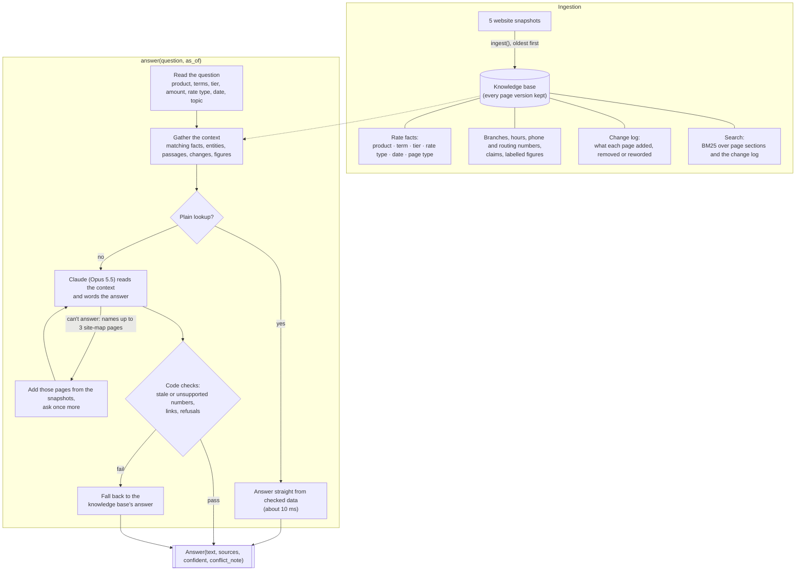

## Notes: a Dupaco knowledge system that knows what's true now

### Author: Pradeep Kumar Vijayakumaran

The solution is in `submission/` (entry point `build()` in `solution.py`). It needs Python 3.9+ and the `anthropic` package, its only dependency (listed in `requirements.txt`, both here and in `submission/`). The website snapshots, harness and questions come with the participant kit and aren't in this repository, so copy `submission/` into the kit folder and run from there:

```
pip install anthropic
python harness/run_eval.py --submission submission --eval eval/public_eval.jsonl
```

## How it works



The `submission/dupaco_qa/` package:

- `pages.py`: page text, types, sections, tables and BM25 search
- `extract.py`: rates and other stated facts
- `conflicts.py`: which value is current, and the contradictions `conflicts()` reports
- `store.py`: the knowledge base, queryable as of any snapshot, with its change log
- `context.py`: reading the question and gathering relevant knowledge
- `answer.py`: the knowledge base's answer, and Claude's answer checked against it

`ingest()` rebuilds the knowledge base from the raw pages on every run (about 8 seconds, standard library only). Nothing is precomputed, and no answers are hard-coded.

Every version of every page is kept, typed by URL (rate sheet, product page, promo, calculator, guide, news, blog, PDF, legal, listing), with menus, footers and related-article lists removed. From each version it extracts:

- Rate facts from tables and sentences, keyed by product, segment, account type, variant (standard or jumbo), purpose, term, tier and rate type, with value, page, page type and "effective as of" date.
- Other facts: routing and phone numbers, branch addresses, hours, openings and closures, dated press-release claims and links.
- Labelled figures written as "Label: value" ("Members: 182,627", "Levy fee: $25.00"), with their document and first appearance.
- A change log of lines added, removed or reworded between snapshots, and pages that appeared or disappeared, ignoring blog and calculator churn, template changes and punctuation edits.
- BM25 indexes over page sections and the change log. Removed text stays searchable, so "is X still offered?" finds where X went away.

`answer()` reads the question into filters (product, term, tier, amount, model year, rate type, date; a date in the question is used when `as_of` is empty), then gathers matching facts and passages. "What changed" questions also get change-log entries and the product's rates in every snapshot; "how many / how much" questions get matching labelled figures, newest first.

Plain lookups (a named product's rate, the routing number, a link, an unpublished rate) come straight from checked data. Everything else goes to Claude (Opus 5.5) with a cached system prompt holding the answering rules, the full rate sheet, key facts and a site map. When search misses because the member's wording differs from the site's ("credit-builder loan" vs "Build Credit and Save"), Claude can request up to 3 site-map pages and try again.

Code checks every Claude answer: outdated or unsupported numbers send it back to the knowledge base's answer, markdown and unrequested web addresses are removed, and a refusal that adds numbers becomes the standard refusal. The knowledge base's answer is also used on an API error or a call over 25 seconds.

## How we decide what's current

1. A fact is identified by product, term, tier and rate type, never by value. 5.39% was the 84-month auto rate in May and is the 60-month rate in September.
2. "As of" a date means the newest snapshot on or before it (a month with no day, such as "May 2026", means its last day). Pages missing from that snapshot carry forward but rank lower.
3. When pages disagree within a snapshot, the winner is decided by, in order: not expired; present in the snapshot; page type (rate sheet, then product page, then promo, then calculator, guide or news, then blog); a table over a sentence; the newer effective date; more pages agreeing.
4. Shifted tiers are the same fact: a calculator's "2023–26" bin competes with the rate sheet's "2024–27" for a 2025 car. For amounts, the tightest matching tier wins, or the highest "Min. to Earn" met, so $150,000 earns the jumbo special.
5. A product official pages stopped listing is discontinued, even if an old page still shows it.
6. For press-release counts and awards, the newest release wins: 22 branches, and Forbes "the fifth time".
7. If the site doesn't say, we don't guess: "That isn't listed on our website. Please contact Dupaco…", with `confident=False`.

`conflicts()` reports stale copies on weaker pages, authoritative values that changed between snapshots, and press releases that disagree, each with values, sources (URL, snapshot, quote), winner and reason. A dividend rate and its APY, identical business and IRA copies, and all tiers of one product and term each count as one entry (`MERGE_TIERS` in `conflicts.py`).

## Design choices

- The knowledge base decides what's true; Claude only reads the question and words the answer. Fixed rules keep rewordings consistent, make every winner explainable, and let it run without an API key.
- All snapshots are kept because "as of", "what changed" and `conflicts()` need the history.
- Structured facts keep near-identical values (60 vs 84 months, 5.39% vs 5.34%, standard vs jumbo, May vs September) apart.
- BM25, not embeddings. With model2vec and fastembed, an even merge made retrieval worse, since near-identical numbers look "similar" to embeddings. As a 2-passage safety net they helped about 1% of questions, barely more than 2 extra keyword passages, and not worth a new dependency, a 29 MB model and longer prompts.
- Plain lookups skip Claude: about 10 ms, cheaper and identical every time.
- Opus 5.5 at low effort: about 3 seconds and 2 to 3 cents per answer. Haiku 5.5 was faster and cheaper but less accurate, and accuracy weighs most (`DUPACO_CLAUDE_MODEL` switches it).
- Images are skipped: the snapshots only link to them, fetching them would be a live website call, and their alt text is mostly blog infographics.
- A given `as_of` overrides any date in the question.
- No per-question tuning: every fix had to be general, and each test set was run blind before anyone read its questions.

## API keys

Claude uses the paid Anthropic API. Put the key in `submission/solution.py` (`ANTHROPIC_API_KEY = ""`, empty in the repository) or the `ANTHROPIC_API_KEY` environment variable; unscoped keys also need `ANTHROPIC_WORKSPACE_ID`. Without a key, or with `DUPACO_NO_LLM=1`, plain lookups still work but how-to, eligibility and "what changed" answers are much weaker, so please use a key.

Optional settings: `DUPACO_CLAUDE_MODEL` (default `claude-opus-5-5`), `DUPACO_CLAUDE_EFFORT` (default `low`), `DUPACO_CLAUDE_TIMEOUT` (default 20 s).

## Testing

Beyond the 40 practice questions, separate agents wrote six blind test sets (334 questions, left out of this repository because they quote the snapshots) from the snapshots and scorer without seeing our code, following the hidden set's description: rewordings, "as of" dates, what changed, tiers, stale traps and refusals. Each set was run once before anyone read it, and used only to find general bugs, such as a related-articles block hiding later FAQs, an ignored date in the question, and "a 30-year fixed" not being read as a mortgage. The harness self-test passes.

## Known limits

- Keyword search can miss pages when wording differs. The site-map look-up recovers many, but only when titles and headings point to the answer; otherwise it declines.
- Search stems words crudely, so "rate" and "rates" don't match; a fix lowered context recall on our test sets, so it was left out.
- Non-rate changes come from the change log, so one worded unlike the question can rank too low.
- Figures inside sentences, wide PDF tables or press-release-only announcements can be missed.
- Fine print (such as a waiting period after closing an account) and staff rosters are found only by search, and were common misses in testing.
- Rule-based question reading can misread an unusual product, term or date and answer only part of the question.
- The locator lists 6 of 22 branches, and hours appear only in opening press releases, so most branches return "not listed". Holiday hours aren't published.
- Some contradictions have no dated winner; the rules decide, and a person might choose differently.
